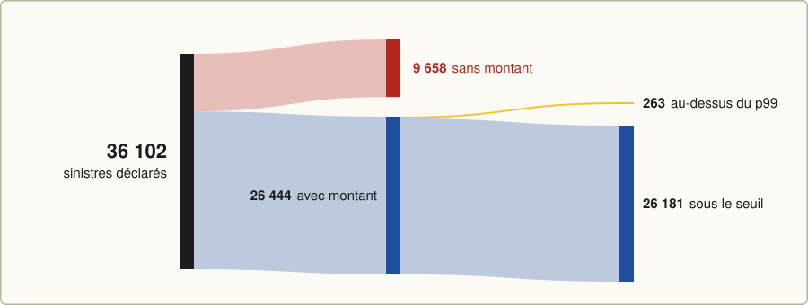
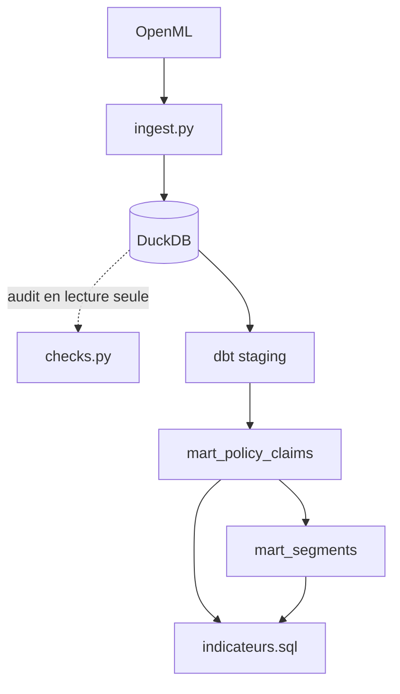
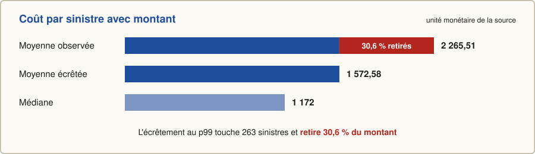
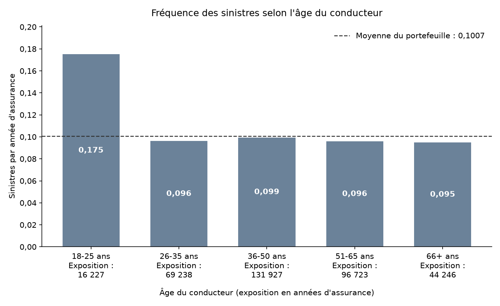

> 26,8 % des contrats sinistrés n'ont aucun montant enregistré. Selon ce qu'on suppose de ce silence, la prime pure vaut 167 ou 228. Ce dépôt documente cet écart sans le cacher.

<p align="center">
  
  
  
  
  
</p>

La **prime pure** est le coût attendu des sinistres par année d'exposition : fréquence × coût moyen. Note : montants dans l'unité monétaire de la source (non précisée par OpenML).

## Le devenir des 36 102 sinistres



| Sinistres | Nombre |
|---|---:|
| Déclarés | **36 102** |
| ↳ sans montant | 9 658 |
| ↳ avec montant | 26 444 |
| &emsp;↳ écrêtés au p99 (plafonnés, pas supprimés) | 263 |
| &emsp;↳ sous le seuil | 26 181 |

## Le procès des hypothèses

Que valent les 9 658 sinistres sans montant ? Les données ne le disent pas.

Constat : la part de sinistres chiffrés va de 22,7 % (véhicules neufs) à 93,6 % (BonusMalus > 100) selon le segment ; l'hypothèse B est donc peu plausible, ce que le logit V1 testera.

<details>
<summary><strong>Hypothèse A : les montants manquants valent 0 → 167</strong></summary>

- Les sinistres sans montant comptent dans la fréquence, mais leur coût est fixé à 0.
- Calcul : montants observés ÷ années d'exposition de tout le portefeuille.
- Sur ce périmètre, c'est un plancher : un montant ne peut pas être négatif.

**Le test logit (V1, pas encore réalisé)** pourra montrer si l'absence de montant dépend de caractéristiques observées. Il ne pourra pas établir que les sinistres manquants coûtent 0, puisque leur montant n'est pas observé.

</details>

<details>
<summary><strong>Hypothèse B : ils ressemblent aux montants observés → 228 (non démontrée)</strong></summary>

- Chaque sinistre sans montant est supposé coûter en moyenne autant qu'un sinistre avec montant.
- Calcul : fréquence × coût moyen observé.
- Ce n'est pas un plafond : des sinistres manquants plus coûteux donneraient davantage.

**Le test logit (V1, pas encore réalisé)** pourra fragiliser cette hypothèse si l'absence de montant dépend de caractéristiques observées. Il ne pourra pas la prouver : il ne dit rien du lien entre l'absence et le montant inconnu.

</details>

## La chaîne de traitement



## Le poids des gros sinistres



Le seuil (16 793,70) est **provisoire** et l'excédent **n'est pas encore mutualisé**. La fourchette de prime pure utilise donc les montants bruts.

## L'âge du conducteur



La fréquence des 18-25 ans (0,175) dépasse nettement celle des autres tranches (de 0,095 à 0,099) : ce constat descriptif n'isole pas l'effet de l'âge.

## Reproduire

Dans PowerShell, depuis la racine du projet. Le chargement des données demande un accès à internet.

```powershell
python -m venv .venv
.venv\Scripts\python.exe -m pip install -r requirements.txt
.venv\Scripts\python.exe ingest.py
.venv\Scripts\python.exe checks.py
.venv\Scripts\dbt.exe run
.venv\Scripts\dbt.exe test
.venv\Scripts\dbt.exe show --select indicateurs --limit 50 --output json
.venv\Scripts\python.exe reports\plot_frequency.py
```

Les chiffres de cette page viennent de [`checks.py`](checks.py), des tests dbt et de [`analyses/indicateurs.sql`](analyses/indicateurs.sql).

## Feuille de route

- [x] Ingestion
- [x] Audit qualité
- [x] Transformations dbt
- [x] 14 tests de qualité des données
- [ ] Test de l'hypothèse de manque (logit)
- [ ] Mutualisation de l'excédent d'écrêtement
- [ ] GLM Poisson + Gamma
- [ ] Power BI
- [ ] Note tarifaire d'une page

## Registre de décisions

<details>
<summary><strong>Sinistres orphelins</strong></summary>

- **Constat :** 6 polices absentes des contrats, soit 195 sinistres et 1,3 % des montants.
- **Décision :** conservés dans le staging, absents du mart.
- **Impact :** exclus de la fréquence et de la prime pure, mais inclus dans le calcul du seuil p99.
- **Fichiers :** [mart](models/marts/mart_policy_claims.sql) et [test `relationships`](models/staging/_staging.yml)

</details>

<details>
<summary><strong>Expositions supérieures à 1</strong></summary>

- **Constat :** 1 224 contrats.
- **Décision :** contrats conservés ; valeur brute (`exposure`), valeur plafonnée à 1 (`exposure_capped`) et signalement (`exposure_flag`).
- **Impact :** la fréquence et la prime pure utilisent la valeur plafonnée.
- **Fichier :** [`stg_policies.sql`](models/staging/stg_policies.sql)

</details>

<details>
<summary><strong>Montants NULL ou 0</strong></summary>

- **Constat :** 9 116 contrats sinistrés sur 34 060 n'ont aucun montant. Avec un sinistre sans montant sur un autre contrat, cela fait 9 658 sinistres sur 36 102.
- **Décision :** montant `NULL` (inconnu) pour ces 9 116 contrats, 0 pour les contrats sans sinistre.
- **Impact :** un coût inconnu n'est pas confondu avec un coût nul.
- **Fichiers :** [mart](models/marts/mart_policy_claims.sql) et [test](tests/assert_total_amount_null_ssi_sinistre_sans_montant.sql)

</details>

<details>
<summary><strong>Seuil p99 provisoire</strong></summary>

- **Constat :** quelques gros sinistres pèsent lourd dans la moyenne.
- **Décision :** écrêtement sinistre par sinistre au p99 (16 793,70), calculé sur les 26 639 lignes de sinistres, orphelines comprises.
- **Impact :** seuil recalculé à chaque `dbt run`, à justifier ; excédent non mutualisé.
- **Fichier :** [mart](models/marts/mart_policy_claims.sql)

</details>

<details>
<summary><strong>Avertissements dbt</strong></summary>

- **Constat :** 12 tests réussissent et 2 émettent un avertissement : 195 sinistres sans contrat (6 polices), et 1 contrat dont `ClaimNb` diffère du nombre de montants.
- **Décision :** les documenter sans bloquer la chaîne.
- **Impact :** un nombre différent de celui indiqué ici doit être examiné.
- **Fichiers :** [test `relationships`](models/staging/_staging.yml) et [test `ClaimNb`](tests/assert_claimnb_matches_amount_lines.sql)

</details>

<details>
<summary><strong>Unité monétaire</strong></summary>

- **Constat :** les descriptions OpenML ne précisent pas la monnaie.
- **Décision :** aucun symbole ; montants dans l'unité monétaire de la source.
- **Impact :** les montants ne doivent pas être convertis ni comparés à une autre monnaie sans vérification.
- **Fichier :** [`indicateurs.sql`](analyses/indicateurs.sql)

</details>
