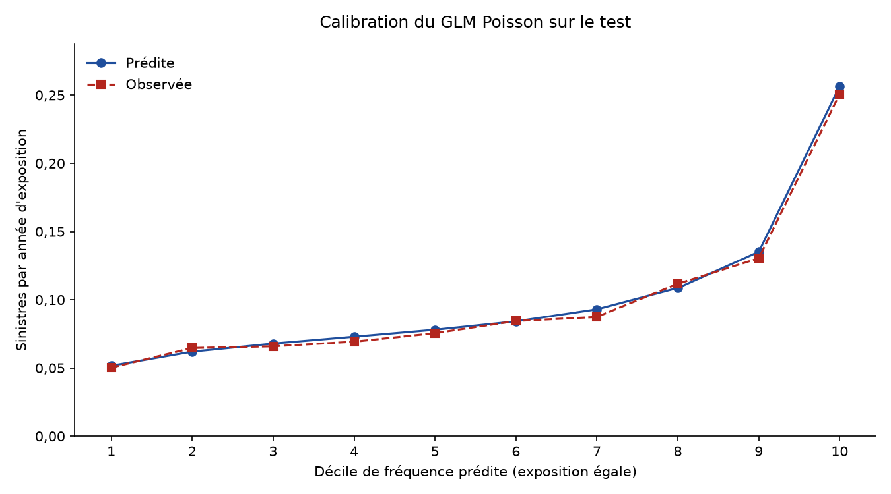

# GLM de fréquence

Fichier produit par `modeling/freq_glm.py`. Train : 542 388 contrats ; test : 135 625 contrats.
Découpage par profil tarifaire (graine 42). Offset : log de l'exposition plafonnée.

Modalités sous 1 000 années d'exposition dans le train, regroupées dans « autres » : VehPower : 14 ; Region : R21, R42, R43.

## Surdispersion

Pearson chi2 / degrés de liberté = **2,410** (seuil retenu : 1,2).
Les 100 plus grands résidus du train portent 24,9 % du chi2.
Quasi-Poisson : mêmes coefficients, erreurs types multipliées par 1,553. Binomiale négative (NB2) : alpha = 0,944.

## Comparaison sur le test

| Modèle | Déviance Poisson moyenne | Gain face à la baseline | Sinistres prédits | Relativité 18-25 (IC 95 %) | AIC (train) |
| --- | ---: | ---: | ---: | ---: | ---: |
| Baseline (fréquence moyenne du train) | 0,326054 | référence | 7 245 |  |  |
| GLM Poisson | 0,310884 | 4,65 % | 7 233 | 0,970 (0,921 à 1,021) | 227 294 |
| GLM quasi-Poisson | 0,310884 | 4,65 % | 7 233 | 0,970 (0,895 à 1,051) | non définie |
| GLM binomiale négative | 0,310969 | 4,63 % | 7 343 | 0,978 (0,925 à 1,033) | 226 606 |

Sinistres observés sur le test : 7 093.

## Effet de l'âge

18-25 ans contre 36-50 ans : GLM 0,970 (IC Poisson 0,921 à 1,021), univarié 1,761 (1,74 par rapport au portefeuille) ; GLM sans BonusMalus : 1,805.

## Calibration par décile (GLM Poisson, test)

| Décile | Contrats | Exposition | Observés | Prédits | Fréquence observée | Fréquence prédite | Observé / prédit |
| --- | ---: | ---: | ---: | ---: | ---: | ---: | ---: |
| 1 | 11 502 | 7 162 | 360 | 370 | 0,0503 | 0,0517 | 0,973 |
| 2 | 11 540 | 7 161 | 463 | 444 | 0,0647 | 0,0620 | 1,043 |
| 3 | 11 806 | 7 161 | 472 | 486 | 0,0659 | 0,0679 | 0,971 |
| 4 | 11 986 | 7 161 | 496 | 522 | 0,0693 | 0,0729 | 0,950 |
| 5 | 12 190 | 7 162 | 541 | 559 | 0,0755 | 0,0781 | 0,968 |
| 6 | 12 409 | 7 161 | 605 | 603 | 0,0845 | 0,0842 | 1,003 |
| 7 | 13 395 | 7 161 | 626 | 666 | 0,0874 | 0,0930 | 0,940 |
| 8 | 14 792 | 7 161 | 800 | 778 | 0,1117 | 0,1086 | 1,028 |
| 9 | 15 593 | 7 162 | 934 | 968 | 0,1304 | 0,1351 | 0,965 |
| 10 | 20 412 | 7 161 | 1 796 | 1 837 | 0,2508 | 0,2566 | 0,977 |

## Relativités

Références : la modalité la plus exposée du train. `Area` et `log(Density)` sont très corrélées : leurs relativités
ne s'interprètent pas séparément. Les intervalles supposent des contrats indépendants.

| Variable | Modalité | Exposition train | Sinistres train | Relativité | IC 95 % Poisson | IC 95 % quasi-Poisson | Relativité binomiale négative | IC 95 % binomiale négative |
| --- | --- | ---: | ---: | ---: | ---: | ---: | ---: | ---: |
| DrivAge | 18-25 | 13 005 | 2 302 | 0,970 | 0,921 à 1,021 | 0,895 à 1,051 | 0,978 | 0,925 à 1,033 |
| DrivAge | 26-35 | 55 365 | 5 349 | 0,715 | 0,690 à 0,740 | 0,677 à 0,755 | 0,711 | 0,685 à 0,737 |
| DrivAge | 36-50 | 105 484 | 10 478 | 1,000 | référence | référence | 1,000 | référence |
| DrivAge | 51-65 | 77 431 | 7 499 | 1,049 | 1,018 à 1,081 | 1,001 à 1,099 | 1,048 | 1,016 à 1,081 |
| DrivAge | 66+ | 35 461 | 3 381 | 1,074 | 1,032 à 1,117 | 1,009 à 1,142 | 1,071 | 1,027 à 1,116 |
| VehAge | 0 | 13 371 | 4 203 | 3,712 | 3,560 à 3,871 | 3,479 à 3,962 | 3,927 | 3,754 à 4,108 |
| VehAge | 1-4 | 89 971 | 8 275 | 1,111 | 1,075 à 1,149 | 1,055 à 1,170 | 1,110 | 1,072 à 1,149 |
| VehAge | 5-9 | 80 233 | 7 948 | 1,203 | 1,166 à 1,241 | 1,146 à 1,262 | 1,203 | 1,165 à 1,243 |
| VehAge | 10+ | 103 173 | 8 583 | 1,000 | référence | référence | 1,000 | référence |
| BonusMalus | 50 | 180 235 | 14 485 | 1,000 | référence | référence | 1,000 | référence |
| BonusMalus | 51-75 | 67 828 | 7 707 | 1,591 | 1,544 à 1,640 | 1,519 à 1,667 | 1,594 | 1,544 à 1,644 |
| BonusMalus | 76-100 | 35 813 | 5 747 | 2,245 | 2,163 à 2,330 | 2,119 à 2,378 | 2,268 | 2,181 à 2,359 |
| BonusMalus | >100 | 2 870 | 1 070 | 5,214 | 4,880 à 5,572 | 4,705 à 5,779 | 5,254 | 4,882 à 5,655 |
| VehPower | 4 | 48 055 | 4 560 | 0,812 | 0,780 à 0,845 | 0,764 à 0,864 | 0,809 | 0,776 à 0,843 |
| VehPower | 5 | 54 712 | 5 890 | 0,983 | 0,949 à 1,019 | 0,930 à 1,040 | 0,981 | 0,945 à 1,018 |
| VehPower | 6 | 65 928 | 6 716 | 1,000 | référence | référence | 1,000 | référence |
| VehPower | 7 | 62 306 | 6 111 | 0,915 | 0,883 à 0,948 | 0,866 à 0,966 | 0,914 | 0,880 à 0,948 |
| VehPower | 8 | 18 121 | 1 553 | 0,752 | 0,711 à 0,796 | 0,689 à 0,821 | 0,747 | 0,705 à 0,792 |
| VehPower | 9 | 12 293 | 1 419 | 1,083 | 1,021 à 1,149 | 0,988 à 1,188 | 1,077 | 1,012 à 1,146 |
| VehPower | 10 | 12 219 | 1 425 | 1,038 | 0,978 à 1,101 | 0,947 à 1,137 | 1,038 | 0,976 à 1,104 |
| VehPower | 11 | 6 776 | 719 | 0,934 | 0,863 à 1,010 | 0,826 à 1,054 | 0,932 | 0,859 à 1,011 |
| VehPower | 12 | 3 051 | 300 | 0,820 | 0,729 à 0,923 | 0,683 à 0,985 | 0,822 | 0,727 à 0,930 |
| VehPower | 13 | 1 330 | 111 | 0,732 | 0,604 à 0,887 | 0,543 à 0,986 | 0,725 | 0,594 à 0,884 |
| VehPower | 15 | 1 005 | 105 | 0,746 | 0,614 à 0,905 | 0,551 à 1,008 | 0,751 | 0,613 à 0,920 |
| VehPower | autres | 951 | 100 | 0,988 | 0,810 à 1,207 | 0,725 à 1,347 | 0,985 | 0,800 à 1,213 |
| Area | A | 49 649 | 4 108 | 0,962 | 0,895 à 1,034 | 0,860 à 1,076 | 0,958 | 0,889 à 1,033 |
| Area | B | 34 408 | 3 026 | 0,978 | 0,927 à 1,030 | 0,901 à 1,061 | 0,976 | 0,924 à 1,031 |
| Area | C | 83 452 | 7 955 | 1,000 | référence | référence | 1,000 | référence |
| Area | D | 61 646 | 6 750 | 1,067 | 1,013 à 1,124 | 0,984 à 1,157 | 1,072 | 1,015 à 1,132 |
| Area | E | 51 093 | 6 255 | 1,072 | 0,984 à 1,168 | 0,938 à 1,225 | 1,079 | 0,986 à 1,180 |
| Area | F | 6 498 | 915 | 1,071 | 0,926 à 1,239 | 0,854 à 1,343 | 1,083 | 0,930 à 1,262 |
| VehGas | Diesel | 136 602 | 13 387 | 0,931 | 0,908 à 0,954 | 0,895 à 0,967 | 0,928 | 0,905 à 0,953 |
| VehGas | Regular | 150 144 | 15 622 | 1,000 | référence | référence | 1,000 | référence |
| VehBrand | B1 | 76 297 | 6 964 | 1,000 | référence | référence | 1,000 | référence |
| VehBrand | B2 | 75 759 | 6 907 | 1,005 | 0,972 à 1,039 | 0,954 à 1,058 | 1,005 | 0,971 à 1,041 |
| VehBrand | B3 | 23 010 | 2 302 | 1,010 | 0,963 à 1,059 | 0,938 à 1,087 | 1,008 | 0,959 à 1,059 |
| VehBrand | B4 | 11 068 | 1 058 | 0,997 | 0,934 à 1,064 | 0,901 à 1,103 | 0,997 | 0,932 à 1,067 |
| VehBrand | B5 | 16 017 | 1 616 | 1,065 | 1,009 à 1,125 | 0,979 à 1,160 | 1,069 | 1,009 à 1,131 |
| VehBrand | B6 | 12 568 | 1 137 | 0,973 | 0,913 à 1,036 | 0,882 à 1,073 | 0,975 | 0,913 à 1,041 |
| VehBrand | B10 | 7 606 | 678 | 1,005 | 0,926 à 1,091 | 0,885 à 1,142 | 1,004 | 0,922 à 1,093 |
| VehBrand | B11 | 5 539 | 583 | 1,149 | 1,052 à 1,254 | 1,003 à 1,316 | 1,149 | 1,048 à 1,259 |
| VehBrand | B12 | 51 760 | 7 117 | 1,174 | 1,128 à 1,222 | 1,104 à 1,249 | 1,177 | 1,129 à 1,227 |
| VehBrand | B13 | 5 332 | 510 | 1,049 | 0,958 à 1,149 | 0,911 à 1,208 | 1,047 | 0,952 à 1,150 |
| VehBrand | B14 | 1 791 | 137 | 0,902 | 0,761 à 1,068 | 0,693 à 1,173 | 0,899 | 0,754 à 1,071 |
| Region | R11 | 24 059 | 3 150 | 0,895 | 0,848 à 0,945 | 0,823 à 0,973 | 0,895 | 0,846 à 0,947 |
| Region | R22 | 2 878 | 370 | 1,040 | 0,936 à 1,156 | 0,883 à 1,226 | 1,044 | 0,934 à 1,166 |
| Region | R23 | 2 532 | 249 | 0,887 | 0,781 à 1,007 | 0,728 à 1,080 | 0,891 | 0,781 à 1,017 |
| Region | R24 | 82 085 | 7 376 | 1,000 | référence | référence | 1,000 | référence |
| Region | R25 | 5 355 | 517 | 0,957 | 0,875 à 1,046 | 0,832 à 1,099 | 0,953 | 0,868 à 1,046 |
| Region | R26 | 4 018 | 420 | 0,961 | 0,870 à 1,060 | 0,824 à 1,120 | 0,958 | 0,864 à 1,062 |
| Region | R31 | 9 218 | 968 | 0,857 | 0,799 à 0,918 | 0,769 à 0,954 | 0,857 | 0,797 à 0,921 |
| Region | R41 | 6 527 | 503 | 0,759 | 0,692 à 0,832 | 0,658 à 0,875 | 0,754 | 0,685 à 0,829 |
| Region | R52 | 17 515 | 1 617 | 0,923 | 0,874 à 0,975 | 0,848 à 1,005 | 0,919 | 0,868 à 0,973 |
| Region | R53 | 22 218 | 2 178 | 1,025 | 0,976 à 1,077 | 0,950 à 1,106 | 1,025 | 0,974 à 1,079 |
| Region | R54 | 8 910 | 765 | 0,869 | 0,807 à 0,937 | 0,774 à 0,976 | 0,866 | 0,802 à 0,936 |
| Region | R72 | 11 456 | 1 090 | 0,864 | 0,810 à 0,922 | 0,782 à 0,956 | 0,860 | 0,804 à 0,920 |
| Region | R73 | 5 599 | 542 | 0,813 | 0,744 à 0,889 | 0,708 à 0,934 | 0,809 | 0,738 à 0,887 |
| Region | R74 | 1 935 | 216 | 1,136 | 0,992 à 1,302 | 0,920 à 1,403 | 1,133 | 0,983 à 1,306 |
| Region | R82 | 36 382 | 4 055 | 1,001 | 0,960 à 1,043 | 0,939 à 1,067 | 1,000 | 0,958 à 1,044 |
| Region | R83 | 1 848 | 157 | 0,706 | 0,602 à 0,828 | 0,551 à 0,904 | 0,703 | 0,596 à 0,829 |
| Region | R91 | 11 812 | 1 260 | 0,911 | 0,856 à 0,969 | 0,828 à 1,002 | 0,913 | 0,856 à 0,974 |
| Region | R93 | 28 610 | 3 121 | 0,911 | 0,871 à 0,954 | 0,849 à 0,978 | 0,909 | 0,867 à 0,953 |
| Region | R94 | 1 405 | 190 | 1,011 | 0,874 à 1,170 | 0,806 à 1,268 | 1,013 | 0,869 à 1,180 |
| Region | autres | 2 384 | 265 | 0,913 | 0,807 à 1,033 | 0,753 à 1,106 | 0,912 | 0,802 à 1,038 |
| log(Density) | par unité | 286 747 | 29 009 | 1,020 | 0,992 à 1,048 | 0,977 à 1,064 | 1,019 | 0,990 à 1,048 |
